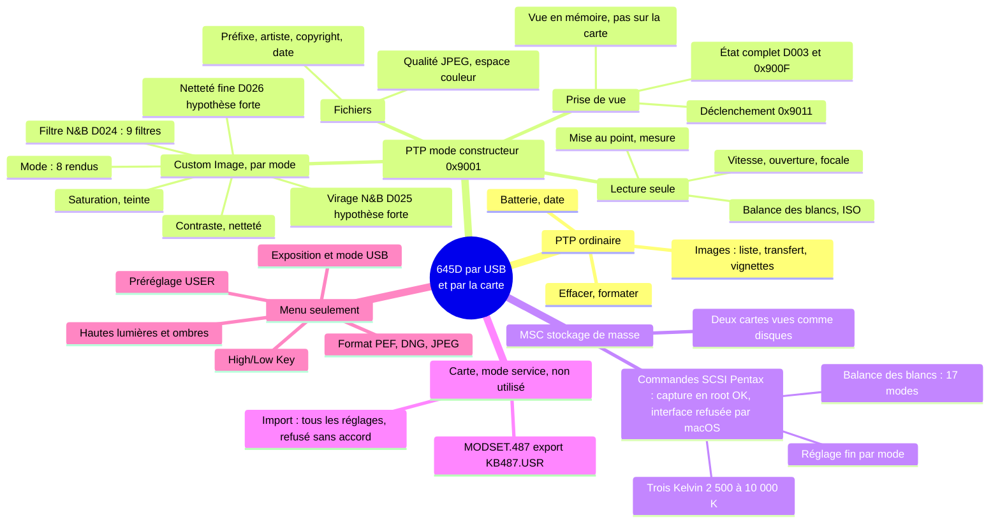

# Pentax 645D : ce que l'USB permet vraiment, mesuré sur le boîtier (octobre 2026)

Règle de Thomas : **aucune modification du firmware du 645D, jamais**. Tout ce qui suit est du **réglage** : des valeurs que les menus du boîtier savent déjà prendre, envoyées par USB, relues, puis remises. Le firmware n'a été ni écrit ni exécuté hors du boîtier.

Légende : **vérifié** = observé sur le boîtier de Thomas (firmware 1.33), avec le journal cité ; **hypothèse** = déduction, à confirmer. L'analyse statique qui a préparé la séance : [`645d-firmware-usb.md`](645d-firmware-usb.md) (adresses du code). Méthode reprise du D750 : [`d750-picture-control-usb.md`](../../d750/recherche/d750-picture-control-usb.md).

## 0. En bref

- **Le mode constructeur s'ouvre** (`0x9001 SetPentaxVendorMode (0x0D, 0x12E08, 1)` → `0x2001`) et le boîtier passe de 23 à 26 opérations. Vérifié.
- **Tout le Custom Image utile est réglable par USB** : le mode (8), et pour chaque mode saturation, teinte, contraste, netteté, netteté fine, et en Monochrome **le filtre** (`D024`, 9 filtres dont Bleu et Cyan) et le virage (`D025`, hypothèse forte). Chaque mode garde ses propres valeurs. Vérifié pour le mode et le filtre, par l'EXIF de la vue prise juste après.
- **Le boîtier se déclenche par USB** (`0x9011 (0, 2, 0)`) et les fichiers se rapatrient (`GetObject`). L'EXIF du PEF note tout le Custom Image (y compris High/Low Key, hautes lumières et ombres, filtre et virage) : la correspondance USB ↔ menu se fait donc seule, vue par vue. Vérifié.
- **Hors d'atteinte du PTP** : la balance des blancs et le Kelvin (lecture seule), High/Low Key, le contraste séparé hautes lumières / ombres, le format de fichier, l'exposition. Vérifié (firmware et sonde). La balance des blancs passerait par le mode MSC : la capture du boîtier marche en root, mais macOS refuse ensuite l'ouverture de son interface de stockage (§6) ; reste à essayer la voie de libusb.
- **N&B** : le Monochrome du boîtier est trop plat (ombres grises, hautes lumières ternes) ; contraste +3 à +4 le rapproche de Tri-X et HP5 de moitié ou plus. Filtres mesurés : aucun pour Tri-X, Cyan pour HP5 (§8). Vérifié.
- **Piège** : la première écriture qui suit une vue, dans la même session PTP, fige l'USB du boîtier (batterie à retirer, deux fois). Une session neuve par vue l'évite (vérifié sur 23 vues, §5).

## 1. Le boîtier sur le bus

| Fait | Statut |
|---|---|
| USB : vendeur `0x25FB` PENTAX, produit **`0xF1`** « 645D » en PTP (classe 6, sous-classe 1, protocole 1), `bcdDevice` `0x0133` = version du firmware 1.33, USB 2.0 | vérifié (`ioreg`) |
| PTP ordinaire : 23 opérations (dont `9001`, `9801` à `9805` MTP), 4 événements (`4002` à `4005`), **5 propriétés** (`5001` batterie, `5011` date, `D303`, `D406`, `D407`), extension `0x6` « microsoft.com/DeviceServices: 1.0; » | vérifié (`sondes/usb/2026-10.30/`), conforme à l'analyse |
| 4 identifiants de stockage annoncés (`0x00010001` à `0x00040001`) pour deux logements de carte ; les vues prises au déclencheur sont écrites sur les deux cartes (réglage de Thomas) | deux cartes identiques : vérifié (lues au lecteur) ; rôle des deux identifiants de plus : hypothèse |
| L'horloge du boîtier a une heure d'avance (restée à l'heure d'été) : `5011` = heure de Paris | vérifié (`5011`, `DateTimeOriginal` du PEF) |

## 2. Mode constructeur

| Fait | Statut |
|---|---|
| `0x9001 (0x0D, 0x12E08, 1)` rend `0x2001` ; `(…, 0)` le referme (`0x2001`) | vérifié |
| En mode constructeur : 26 opérations, **`9003`, `9004`, `900F`, `9011`, `9012` en plus, `100B` DeleteObject et `100F` FormatStore en moins** ; extension annoncée `0x0D` « pentax.jp: 1.0; » | vérifié (`deviceinfo-constructeur.bin`) |
| **Contrairement à l'analyse statique, `DeviceInfo` annonce toujours 5 propriétés**, mais `GetDevicePropDesc` répond pour les 52 codes de la liste du firmware | vérifié (`sondes/usb/2026-10.31/`) |
| **Balayage complet** de `0x5000` à `0x50FF` et de `0xD000` à `0xD2FF` en mode constructeur : aucune propriété en dehors de ces 52 | vérifié (`sondes/usb/2026-10.32/proprietes.tsv`) |
| `0x900F` (GetAllConditions) rend 110 mots : le nombre 109, puis le tableau `D003` à deux mots près (`D003[8]` et `D003[32]`) | vérifié |

### 2.1 Propriétés lues (descripteur décodé, valeurs de départ de Thomas)

| Code | Rôle | Type, accès | Valeurs permises | Valeur lue | Statut du rôle |
|---|---|---|---|---|---|
| `5004` | qualité JPEG | UINT8, RW | 0, 1, 2 | 2 | vérifié (PTP) |
| `5014` | contraste du mode courant | UINT8, RW | 0 à 8 (4 = 0) | 4 | vérifié (PTP + EXIF) |
| `5015` | netteté du mode courant | UINT8, RW | 0 à 8 | 4 | vérifié (PTP + EXIF) |
| `D013` | entraînement | UINT32, RW | 0 à 7 | 0 | hypothèse (pkTriggerCord) |
| **`D020`** | **mode Custom Image** | UINT8, RW | 0 à 7 | 0 (Naturel) | vérifié : 0 = Natural, 5 = Monochrome (EXIF `ImageTone`) ; 1 à 4, 6, 7 : à relever |
| `D021` | saturation (paramètre 1) | UINT8, RW | 0 à 8 | 4 | vérifié (PTP) ; en Monochrome vaut le filtre |
| `D022` | teinte (paramètre 2) | UINT8, RW | 0 à 8 | 4 | vérifié (PTP) |
| `D023` | inconnu | UINT8, RW annoncé | 0 à 8, défaut 4 | 0 | écriture toujours refusée d'après le firmware |
| **`D024`** | **filtre Monochrome** | UINT8, RW | 0 à 8 | 0 en Monochrome | **vérifié** : `D024 = 6` donne `MonochromeFilterEffect : Blue` (ordre du manuel : aucun, vert, jaune, orange, rouge, magenta, bleu, cyan, infrarouge) |
| `D025` | virage Monochrome | UINT8, RW | 0 à 8 | 4 | hypothèse forte (jumeau de `D022`) |
| `D026` | netteté fine | UINT8, RW | 0, 1 | 0 | hypothèse forte |
| `D027` | inconnu (paramètre booléen) | UINT8, RW | 0, 1 | 0 | à relever |
| `D028` | inconnu | UINT8, RW annoncé | 0, 1 | 0 | écriture toujours refusée d'après le firmware |
| `D029` | espace couleur | UINT32, RW | 0, 1 | 0 (sRGB) | vérifié (EXIF `ColorSpace : sRGB`) |
| `D032` | préfixe des fichiers | STR, RW | | « THAM » (défaut « IMGP ») | vérifié (nom `THAM3246.PEF`) |
| `501E`, `501F` | artiste, copyright | STR, RW | | « Thomas Hammoudi » | vérifié |
| `D001` | identité | AUINT32, R | | `0x12E08`, 487, … | vérifié |
| `D002` à `D005` | tableaux d'état ([00 08] en entier pour `D003`, 109 mots) | AUINT32, R | | | vérifié (contenu) ; sens des mots : en cours |
| `5005`, `5007`, `500A` à `5013`, `501C` | balance des blancs, ouverture, mise au point, mesure, flash, vitesse, programme, ISO, correction… | **lecture seule** | listes annoncées (balance : 17 valeurs, `0x0002`, `0x0006`, `0x0007`, `0x8001` à `0x800E`) | **le boîtier rend le code de la propriété au lieu de sa valeur** (`5005` → 20485) ; descripteur sans valeur par défaut ni courante, suivi de restes de tampon | vérifié ; défaut du firmware, sans conséquence |
| `D006`, `D011`, `D012`, `D014` à `D017`, `D01A`, `D01B`, `D01F`, `D030`, `D031` | coquilles vides | type 0, valeur vide | | | vérifié |

### 2.2 Les 8 modes et leurs réglages au départ (relevé par USB)

Relevé par `645d_seance.swift --sauver` : le mode a été changé 7 fois par USB, puis remis à Naturel. **Chaque mode garde ses propres valeurs**, vérifié. Sauvegarde : [`sondes/usb/seance-2026-10/avant-reglages.json`](../sondes/usb/seance-2026-10/avant-reglages.json). Valeurs brutes (4 = 0).

| Mode (code USB) | saturation / filtre | teinte / virage | contraste | netteté |
|---|---|---|---|---|
| 0 Naturel | 4 | 4 | 4 | 4 |
| 1 Lumineux | 4 | 4 | 5 | 5 |
| 2 Portrait | 4 | 4 | 4 | 4 |
| 3 Paysage | 4 | 4 | 5 | 5 |
| 4 Vibrant | 4 | 4 | 4 | 4 |
| 5 Monochrome | 0 (aucun filtre) | 4 | 4 | 6 (+2) |
| 6 Atténué | 4 | 4 | 1 (−3) | 2 (−2) |
| 7 Inversion film | 4 | 4 | 4 | 4 |

Noms des modes 1 à 4, 6, 7 : ceux de pkTriggerCord, à confirmer par l'EXIF (§4).

## 3. Déclenchement et rapatriement

| Fait | Statut |
|---|---|
| `0x9011 (p1, p2, p3)` : p1 = 0 vue unique, 1 rafale, 2 pose B (commandes internes `[10 0C]` et `[10 0D]`) ; p2 = appui transmis à `[10 05]` (2 = à fond, 1 = mi-course selon pkTriggerCord) ; p3 ≤ 1, non utilisé dans le gestionnaire | code : vérifié (`0x10821140`). Ghidra affichait `FP+4` pour l'argument de `[10 05]` : son module FR60 étend mal `ADDN2 #i4` (octets `a1 4c` = −12, donc `FP−12` = p2) |
| `0x9011 (0, 2, 0)` déclenche ; le PEF apparaît dans `GetObjectHandles` et se rapatrie par `GetObject` (44 à 53 Mo) | vérifié |
| **Une vue déclenchée par USB n'est pas écrite sur la carte** : le boîtier la garde en mémoire sous un nom provisoire, la sert par `GetObject`, puis l'oublie à la fin de la session. Les 23 vues de la séance de, non rapatriées sur le moment, sont absentes des deux cartes, dont le compteur s'arrête à `THAM3248` ; la vue d'essai `THAM3246` de et la vue au déclencheur `THAM3246` de portent le même numéro | vérifié (cartes lues au lecteur, journal de séance) |
| Le boîtier était en PEF seul (`Quality : RAW`) : l'aperçu JPEG du PEF ne fait que 640 × 480. Le format (RAW+ = PEF + JPEG) ne se règle pas par USB | vérifié (EXIF ; absence dans le répartiteur PTP) |
| **L'EXIF Pentax du PEF note tout le Custom Image** : `ImageTone`, `Saturation`, `Hue`, `Contrast`, `Sharpness`, `FineSharpness`, `HighLowKeyAdj`, `ContrastHighlight`, `ContrastShadow`, `ContrastHighlightShadowAdj`, `MonochromeFilterEffect`, `MonochromeToning` | vérifié (`exiftool` 13.55) |

## 4. Correspondance USB ↔ menu (par l'EXIF)

| Écrit par USB | EXIF de la vue | Statut |
|---|---|---|
| `D020 = 5`, `D024 = 6` | `ImageTone : Monochrome`, `MonochromeFilterEffect : Blue`, `MonochromeToning : 0`, `Sharpness : Hard` (le +2 de Thomas) | vérifié (vue 1, `01-mono-d024-6-THAM3247.PEF`) |
| la suite du plan (virage, netteté fine, `D027`, Naturel, modes 1 à 7) | | à faire : séance interrompue (§5) |

## 5. Le piège : écrire juste après une vue

| Fait | Statut |
|---|---|
| **Dans une même session PTP, la première `SetDevicePropValue` qui suit un déclenchement `0x9011` reste sans réponse**, et plus rien ne répond ensuite (les lectures d'avant passent) : le boîtier a dû être éteint, batterie retirée. Deux fois : (`D021` après la vue 1) (`D024` après la vue 1, malgré 2 s de pause et une lecture réussie) | vérifié (journaux de séance) |
| **Contournement** : après chaque vue, refermer le mode constructeur et la session PTP, en rouvrir une, attendre que le tableau `D003` ne bouge plus (lectures), puis écrire. Aucune écriture bloquée sur la séance de mesure (vues 2 à 24) | vérifié (séance de) |
| Cause exacte : non trouvée. Le gestionnaire de `0x9011` passe par `[00 09]` (2) et les commandes du groupe `0x10` ; le groupe `0x18` (écritures) attend une condition d'état (`0x10659670`) ; `0x9012` (fin de prise, `[10 0C]` 0 et `[10 0D]` 0) n'a pas été essayé | hypothèse |
| **Retirer la batterie efface tout ce qui a changé depuis la dernière extinction normale** : le mode USB est revenu de PTP à MSC, et les deux écritures de (mode Monochrome, filtre Bleu) avaient disparu au redémarrage. Un réglage n'est gardé qu'à l'extinction par l'interrupteur | vérifié (relevés de et) |
| Pendant que le boîtier était en MSC, Image Capture montrait « 645D » et « 645D 1 » : ce sont les deux cartes montées comme disques, pas des connexions fantômes. Les outils ignorent désormais les appareils de type stockage de masse | vérifié (`transportType` = `ICTransportTypeMassStorage`) |

Règles retenues : une session neuve par vue ; filtre Monochrome écrit par `D024` (`D021` est la même case) ; arrêt net de l'outil à la première commande sans réponse ; arrêt automatique du boîtier au plus long pendant une séance ; s'il faut redémarrer, d'abord l'interrupteur.

## 6. Mode MSC

| Fait | Statut |
|---|---|
| Le menu R2 « USB Connection » propose MSC ou PTP ; le PTP ne règle ni la balance des blancs ni le Kelvin, que le firmware accepte par les commandes SCSI Pentax `[18 10]`, `[18 11]`, `[18 24]` en MSC | vérifié (manuel, analyse du firmware) |
| macOS : le pilote de stockage de masse garde l'interface pour lui ; le seul moyen sans extension ni logiciel tiers est de **capturer le périphérique** avec le framework `IOUSBHost` (fourni avec macOS) et de parler Bulk-Only (CBW/CSW) soi-même. L'en-tête Apple l'écrit : « If the caller has root privelages the entitlement and authorization is not needed » ; la capture démonte la carte et coupe les autres pilotes, qui reviennent à la fin | vérifié (`IOUSBHostDefinitions.h` du SDK macOS) |
| Il faudrait donc : un client Swift d'environ 200 lignes (capture, CBW avec l'opcode `0xF0` et les sous-commandes `0x24`, `0x4F`, `0x26`, `0x49` de pkTriggerCord), **lancé en `sudo` par Thomas** (mot de passe tapé par lui), boîtier en MSC. Rien à installer. libusb (Homebrew) ferait la même chose, mais c'est une installation | vérifié (en-tête) ; acceptation des commandes par le 645D : à tester |
| En MSC (produit **`0xF0`**, interface classe 8, sous-classe 6 SCSI, protocole `0x50` Bulk-Only), le boîtier présente **deux unités logiques** (LUN 0 et 1 = les deux logements), identité SCSI « PENTAX / DSC_645D / 1.33 », type 0 ; macOS monte les deux cartes (`/Volumes/645D`, `/Volumes/645D 1`) | vérifié (`ioreg`, `diskutil`) |
| `0xF0` = MSC et `0xF1` = PTP : les deux identifiants de l'en-tête du firmware | vérifié |
| **Essai d’octobre** (`645d_scsi.swift` lancé en root par la fenêtre d'autorisation de macOS, `645d_scsi.sh`) : démontage des deux cartes et **capture du périphérique réussis** ; ensuite macOS **refuse d'ouvrir l'interface de stockage** : `IOServiceOpen` rend `0xe00002e2` (kIOReturnNotPermitted), même en root, même une fois le pilote de stockage parti (0 client), pendant 10 s. La 2e voie (reconfiguration sans pilote) n'a pas pu être jugée : l'outil s'est bloqué sur sa propre lecture du registre (corrigé depuis). Aucune commande n'a atteint le boîtier | vérifié (journal `sondes/usb/scsi-essais-2026-10.txt`) |
| IOUSBHost plante (NSException « attempt to insert nil object ») au lieu de rendre l'erreur quand l'ouverture est refusée, en root : l'outil fait donc l'ouverture lui-même avant d'appeler le framework | vérifié (désassemblage de `-[IOUSBHostObject openWithOptions:error:]`, 3 plantages) |
| Voie restante sans rien installer : celle de libusb, l'API USB plus ancienne d'IOKit (`USBDeviceReEnumerate` avec `kUSBReEnumerateCaptureDeviceMask` en root, puis `USBInterfaceOpen`) ; ou libusb lui-même (Homebrew, installation à demander) | hypothèse (libusb détache ainsi les pilotes en root sur macOS) ; non essayé |
| Le mode USB ne se change pas depuis l'ordinateur : il se choisit au branchement d'après le menu R2 | vérifié (aucune commande PTP ou SCSI vue pour lui dans le firmware) ; à l'usage |

## 7. Export des réglages (`MODSET.487` → `KB487.USR`)

Non fait : attend l'accord explicite de Thomas, après explication (voir [`645d-firmware-usb.md`](645d-firmware-usb.md) §6 et §8, piste 2).

## 8. Presets perso : ce qui est faisable

### 8.1 Mesure du Monochrome (séance 2, octobre)

30 vues par USB, trépied, pédalier, 1/4 s, f/4, ISO 200, balance auto ; une seule chose change d'une vue à l'autre. Chaque gris du JPEG intégré au PEF (7264 × 5440, rendu Custom Image) est comparé au RVB linéaire du même endroit tiré du RAW (`raw_lineaire`), par blocs de 8 px uniformes communs à toutes les vues Monochrome (1 224 blocs) ; ajustement gris = T(w · RVB), T croissante quelconque (`645d_mesure.py nb`, résultats `sondes/usb/seance-2026-10/nb-mesure-2.json`).

| `D024` (filtre) | Poids R / V / B (sRGB linéaire) | Statut |
|---|---|---|
| 0 aucun | 0,255 / 0,519 / 0,226 | vérifié (mesure) |
| 1 vert | 0,139 / 0,670 / 0,191 | vérifié |
| 2 jaune | 0,293 / 0,514 / 0,193 | vérifié |
| 3 orange | 0,596 / 0,236 / 0,167 | vérifié |
| 4 rouge | 0,694 / 0,113 / 0,192 | vérifié |
| 5 magenta | 0,491 / 0,206 / 0,303 | vérifié |
| 6 bleu | −0,081 / 0,151 / 0,930 | vérifié |
| 7 cyan | −0,043 / 0,391 / 0,652 | vérifié |
| 8 infrarouge (simulé) | 0,651 / 0,926 / −0,577 | vérifié |

- Le contraste, le virage, `D026` et `D027` ne changent pas les poids (écart ≤ 0,002). Vérifié.
- **Virage** `D025` : 2 = froid (R − B = −40 niveaux), 6 = chaud (+57) ; 4 = neutre. Vérifié (mesure).
- `D026` et `D027` à 1 : aucun effet sur les tons des blocs. Vérifié ; effet sur le détail fin non mesuré.

### 8.2 Le N&B du boîtier face à Tri-X et HP5

Le défaut principal est la **courbe**, pas le filtre. Au contraste 0 (réglage de départ), gris du boîtier / gris du film par IL autour du gris moyen : −2 IL 42/37, −1 IL 79/67, 0 IL 121/120, +1 IL 173/180, +2 IL 213/223 (cible Tri-X, `donnees-films/hp5-trix-cibles.json`) : ombres grises, hautes lumières ternes. Écart moyen, en niveaux sur 255 :

| Contraste | −4 | −2 | 0 (départ) | +2 | +4 |
|---|---|---|---|---|---|
| Tri-X | 14,5 | 10,1 | 6,7 | 4,6 | **4,2** |
| HP5 | 17,6 | 13,1 | 9,8 | 6,4 | **3,3** |

Couleur (filtre seul, écart quadratique en IL sur les 18 cases colorées d'une ColorChecker) : **Tri-X** aucun 0,44, vert 0,48, jaune 0,51 ; **HP5** cyan 0,52, vert 0,71, aucun 0,72. Aucun filtre ne s'approche mieux : il manquerait un filtre bleu clair (les films voient plus le bleu que le boîtier sans filtre, moins que le filtre Cyan). Vérifié (calcul sur les poids mesurés) ; le ciel restera plus sombre qu'en Tri-X.

### 8.3 Couleur face aux cibles du D750 (sans nouvelle vue)

Mêmes 30 vues : les modes 0 à 7 (sauf 5) **tous paramètres à 0** (saturation, teinte, contraste, netteté), et Naturel avec saturation −4, −2, +2, +4 et teinte −2, +2. Chaque rendu est comparé aux cibles construites pour le D750 (`d750/outils/d750_cibles.py`, mêmes blocs, exposition libre de −1,5 à +1,5 IL ; ΔE2000 médian ; `sondes/usb/seance-2026-10/couleur-mesure-2.json`).

| Cible | Meilleur rendu 645D | ΔE médian (p90) |
|---|---|---|
| Classic Chrome | Naturel, teinte −2 | **1,9** (3,9) |
| Portra (le preset tel que Thomas le règle) | Lumineux, tout à 0, −0,2 IL | 2,3 (4,9) |
| Esprit Portra (preset tiré vers les scans de Thomas) | Naturel saturation +2, −0,5 IL ; Lumineux tout à 0 : 3,2 | 3,1 (4,7) |
| Positive | Naturel saturation +4 | 3,5 (5,5) |
| Classic Neg | Naturel, teinte −2 | 3,2 (7,9) |

Limite : le pédalier a peu de couleurs vives (chroma médiane 5) ; le classement porte surtout sur la tonalité et la teinte des gris. Peau, ciel, feuillage : non vérifiés (une vue de la bibliothèque ou d'un visage le dirait). Hypothèse pour les couleurs saturées.

### 8.4 Recettes chargées dans le boîtier (octobre)

| Où (nom du menu, fixe) | Recette | Valeurs USB | Statut |
|---|---|---|---|
| Naturel (mode actif) | **Classic Chrome** | `D022` 2 (teinte −2), le reste à 0 | vérifié (EXIF, vues `THAM3303`, `THAM3311`) |
| Lumineux | **Portra** (exposer −⅓ à −½ IL) | tout à 0 (contraste et netteté étaient à +1) | vérifié (EXIF `THAM3302`) |
| Monochrome | **Tri-X** | `D024` 0, `D025` 4, contraste +3 (`5014` 7), netteté +2 | vérifié (EXIF `THAM3304`, `THAM3307`, `THAM3310`) ; contraste +3 lui-même non mesuré (entre +2 et +4) |
| Molette **USER** | **HP5** | Monochrome, `D024` 7 (Cyan), contraste +4 (`5014` 8), netteté +2 | vérifié : vue prise molette sur USER (`THAM3309`) en Monochrome Cyan, et hors USER le Monochrome reste Tri-X |
| Portrait, Paysage, Vibrant, Atténué, Inversion film | inchangés | | aucun plan n'y écrit (journaux) ; valeurs du §2.2 |

- **Les noms ne se changent pas** : ils sont dans le firmware, aucune propriété USB n'en porte un (la seule chaîne réglable est le préfixe des fichiers, `D032`). Vérifié (52 codes lus, §2).
- **Le préréglage USER garde son propre Custom Image** (mode et paramètres) : c'est un 2e emplacement Monochrome. Vérifié. Il s'enregistre au menu (A4), pas par USB.
- **Grain** : aucun réglage en Custom Image. Plus de modelé : contraste des hautes lumières / des ombres et High/Low Key, au menu seulement (§0), à mesurer de la même façon.
- **Chargement** : par PTP, `645d_seance.swift` (plan JSON, une vue de contrôle par recette) ; plans dans `sondes/usb/seance-2026-10/plan-recettes-*.json`. Retour à l'état d’octobre : `--remettre` (vérifié deux fois). Les recettes restent après un arrêt par l'interrupteur, pas après un retrait de la batterie (§5).

## 9. Carte des fonctions

Ce que chaque voie permet sur le 645D (firmware 1.33). Vérifié sur le boîtier sauf mention ; « menu seulement » = ni le PTP ni le SCSI ne l'atteignent.

## Outils et journaux

- [`../outils/645d_ptp.swift`](../outils/645d_ptp.swift) : sonde en lecture seule (`--constructeur`, `--balayage`), descripteurs décodés dans `proprietes.tsv`.
- [`../outils/645d_etat.swift`](../outils/645d_etat.swift) : relevé de l'état comparé au précédent, ou suivi continu pendant que Thomas règle au menu (lecture seule).
- [`../outils/645d_seance.swift`](../outils/645d_seance.swift) : `--sauver`, `--essai`, plan de vues, `--remettre`, `--rapatrier`.
- [`../outils/645d_mesure.py`](../outils/645d_mesure.py) : `extraire` (blocs JPEG intégré ↔ RAW linéaire), `nb` (poids des filtres, courbes, comparaison Tri-X / HP5).
- [`../outils/645d_scsi.swift`](../outils/645d_scsi.swift) et [`../outils/645d_scsi.sh`](../outils/645d_scsi.sh) : client SCSI Pentax en MSC (lecture seule), lancé en root par la fenêtre d'autorisation de macOS ; bloqué à l'ouverture de l'interface (§6).
- Recettes et plans de chargement : [`../recettes/`](../recettes/recettes-645d.json) ; mode d'emploi : [`../README.md`](../README.md).
- Journaux : [`../sondes/usb/`](../sondes/usb/).
