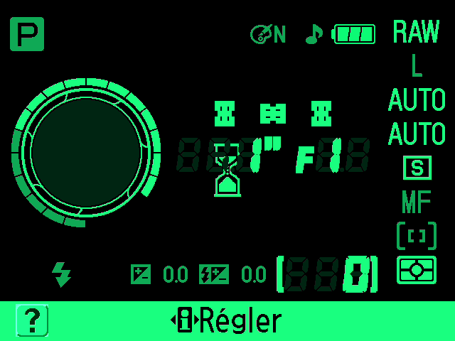
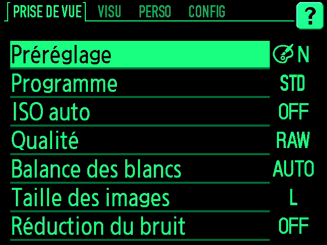
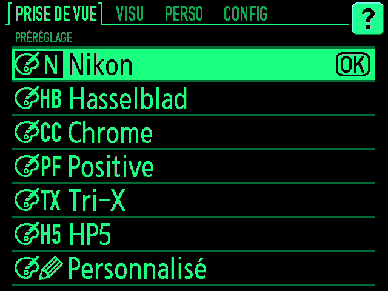
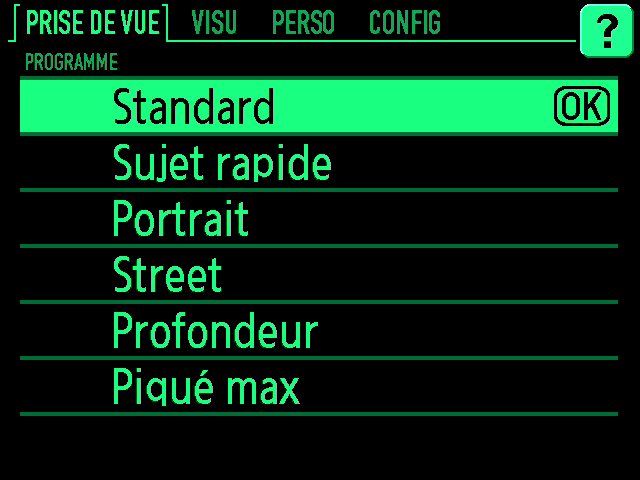
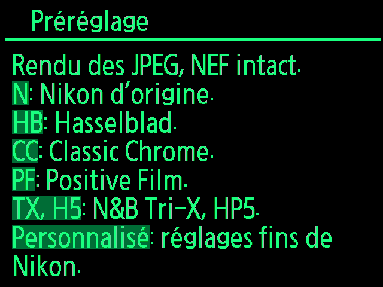
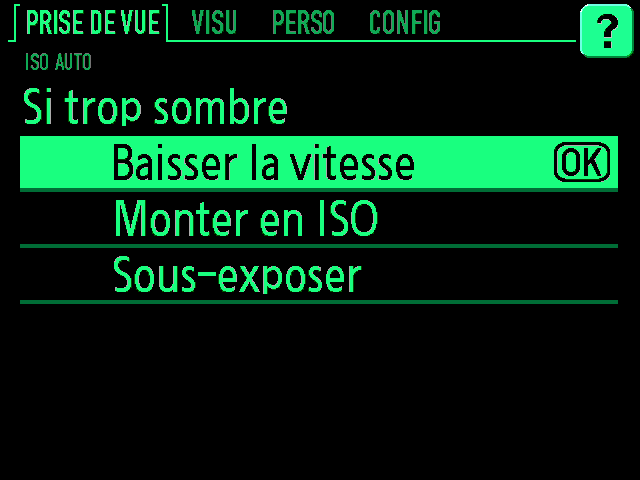

# Nikon D40 : la V5

Un D40 de 2006 qui sort en JPEG direct cinq looks (Hasselblad, Classic Chrome, Positive, Tri-X, HP5), avec un menu façon Pip-Boy et de vrais programmes d'exposition. Flashée sur mon boîtier en octobre 2026, utilisée depuis.

| Entrée du menu Préréglage | Nom gardé dans l'EXIF | Look | Écart mesuré (ΔE2000 médian, p90) |
|---|---|---|---|
| Hasselblad | Soft | rendu HNCS du Hasselblad X2D | 2,7 (3,8), 1 vue |
| Chrome | Vivid | Classic Chrome (JPEG du Fujifilm X-T4) | 1,4 (2,7), 1 vue |
| Positive | More Vivid | Positive (Ricoh GR III) | 1,6 (2,8), 3 vues |
| Tri-X | Portrait | Tri-X 400, d'après un preset acheté que j'aimais beaucoup | 0,5 (2,8), 4 vues |
| HP5 | Black And White | HP5+ (fiche Ilford, tirage grade 2) | 2,7 (4,6), 11 vues |

Le menu garde aussi Nikon (rendu d'origine) et Personnalisée ; la photo note le préréglage dans le champ « Optimiser l'image » de Nikon, recyclé. Mesures et réserves : [`../d750/recherche/resultats-mesures.md`](../d750/recherche/resultats-mesures.md) (partie D40).

Programmes (en P seulement) : Standard (ligne de Nikon), Sujet rapide (pleine ouverture, 1/500 mini), Portrait (pleine ouverture, 1/125), Street (f/5,6, 1/250), Profondeur (f/11, 1/focale), Piqué max (pleine ouverture + 2 IL, bornée à f/5,6–f/8, 1/focale). Un programme met l'ISO auto en marche, avec l'ISO maxi réglé : l'ISO monte pour tenir l'ouverture et la vitesse.

## Le menu Pip-Boy

Ce sont des **captures de l'émulateur**, pas des photos de l'écran : le vrai firmware V5 tourne sur l'ordinateur ([`emulateur/`](emulateur/README.md)), et chaque image est son écran tel qu'il l'affiche. Les 27 captures et la façon de les refaire : [`captures-emulateur-v5/`](captures-emulateur-v5/LISEZMOI.txt).

| | |
|---|---|
|  |  |
| Écran d'infos de prise de vue | Onglet PRISE DE VUE |
|  |  |
| Les préréglages, un par look | Les programmes d'exposition, en P |
|  |  |
| L'aide « ? » de chaque entrée | ISO auto : que faire si la scène est trop sombre |

## Comment on a fait

Le détail, jour par jour et preuve par preuve : [`NOTES-TECHNIQUES.md`](NOTES-TECHNIQUES.md) ; la carte du firmware : [`CARTE.md`](CARTE.md).

1. **Le firmware est chez Nikon, en clair.** Deux processeurs : le B (4 Mo : image, interface, fichiers, USB) et le A (256 Ko : exposition, flash, molette). Chaque fichier finit par un CRC16 XMODEM ; le boîtier vérifie aussi la taille et une signature. Rien d'autre : un fichier modifié au bon CRC est accepté.
2. **La carte** : désassemblage avec Ghidra et l'extension ghidra-fr60 (processeur Fujitsu FR, noyau µITRON), symboles nommés et vérifiés un par un ([`desassemblage/`](desassemblage/), `regenerer.sh` refait tout depuis le binaire). On y a trouvé les 28 courbes de tonalité (format décodé, réencodé à l'octet près), les matrices couleur, un étage de correction à 16 secteurs de teinte, les réglages de chaque préréglage, les textes et les menus.
3. **Les sondes** : deux firmwares « données seules » qui changent des tables de façon reconnaissable, photographiés, pour établir ce que fait chaque table (par exemple l'ordre et l'angle des 16 secteurs de teinte).
4. **Le simulateur** ([`outils/simulateur.py`](outils/simulateur.py)) refait le JPEG du D40 à partir d'un NEF, avec les tables d'origine ou patchées : 0,9 à 2,8 de ΔE contre les vrais JPEG. Les looks sont calculés dessus : matrices par balance, courbe 12 bits avec une épaule de film, secteurs de teinte, matrice YCbCr ([`outils/recettes_v1.py`](outils/recettes_v1.py), recettes dans [`recettes/v1/`](recettes/v1/), rendus mesurés dans [`recettes/mesures/`](recettes/mesures/)).
5. **L'émulateur** ([`emulateur/`](emulateur/README.md)) fait tourner le vrai firmware B sur le Mac (démarrage, noyau, 24 tâches, menus, touches, captures d'écran), et la chaîne d'exposition du A. Chaque patch y passe une batterie de scénarios avant tout flash.
6. **Les patchs** ([`outils/pipboy.py`](outils/pipboy.py), [`outils/preglages_v1.py`](outils/preglages_v1.py), [`outils/programmes_a.py`](outils/programmes_a.py)) : un crochet de 200 octets dans le chargement de la puce de traitement d'image remplace matrice, secteurs et courbe quand un des cinq préréglages est choisi (en P, S, A, M) ; le menu Pip-Boy est fait de textes, palettes, glyphes et listes de menu réécrits ; les programmes passent par un octet que le B envoie déjà au A : l'étape 9 détourne la préparation de la copie envoyée au A (`liaisonA_preparer`, `0xA9516`) pour y glisser le programme, en P seulement, et 230 octets ajoutés au A restent dormants tant que le B ne les demande pas.

## Fabriquer la V5 depuis le firmware officiel

Le dépôt ne contient aucun octet du firmware de Nikon : seulement les remplacements, et l'empreinte sha256 de chaque zone d'origine pour vérifier qu'on part du bon fichier.

1. Télécharger chez Nikon (accepter leurs conditions) :
   - le **firmware A 1.12** : <https://downloadcenter.nikonimglib.com/en/download/fw/6.html> (`F-D40-V112W.exe`) ;
   - le **firmware B 1.11** : <https://downloadcenter.nikonimglib.com/en/download/fw/119.html> (`d40v111en.exe`).
   Ce sont des archives RAR auto-extractibles : `brew install unar` (ou 7-Zip) les ouvre sans rien exécuter. Le script accepte aussi les `.bin` déjà extraits (`AD400112.bin`, `BD400111.bin`).
2. Lancer :
   ```
   python3 d40/fabriquer_v5.py F-D40-V112W.exe d40v111en.exe
   ```
   Il vérifie les originaux (sha256 de Nikon), les range dans `d40/firmware/` (hors git), applique [`patchs/a-programmes-112.json`](patchs/a-programmes-112.json) au A et [`patchs/v5-programmes.json`](patchs/v5-programmes.json) au B, et contrôle le résultat :

   | Fichier | CRC | sha256 |
   |---|---|---|
   | `d40/build/V5/1-en-premier-processeur-A/AD400112.BIN` | `ee7d` | `45a686a71b65d964390c3d6d1095fd6e9bd5467d87bfa55b34e663b3ac8f9df2` |
   | `d40/build/V5/2-ensuite-processeur-B/BD400111.BIN` | `14b3` | `bfa6eb0b0e528cbc4bed37ff12c884b95029d1e5d85093e0dc43bb58c9efd1ba` |

   Code de sortie 0 seulement si les deux empreintes sont celles de la V5 flashée et testée. Les mêmes fichiers sont dans la release `d40-v5`, fournis pour commodité : c'est un firmware Nikon modifié, sans garantie, dont les droits restent à Nikon.

## Flasher

**Risque** : un firmware modifié peut rendre le boîtier inutilisable. Le B se reflashe tant que le boîtier démarre ; pour le A, il n'existe aucune voie de secours par la carte (étude : [`recherche/etude-a/`](recherche/etude-a/)). Le patch du A a été rejoué dans l'émulateur (12 contrôles sur 12, dont 120 cas d'exposition) et flashé sur mon boîtier, mais l'émulateur ne prouve pas tout (les deux processeurs n'y tournent jamais ensemble). À faire seulement si l'on accepte de perdre le boîtier.

1. Vérifier la version : CONFIG › Version du firmware doit afficher **A 1.12 et B 1.11** (les dernières de Nikon ; sinon, faire d'abord la mise à jour officielle).
2. Accumulateur EN-EL9 plein. Carte formatée dans le boîtier.
3. **D'abord le A** : copier `1-en-premier-processeur-A/AD400112.BIN` seul à la racine de la carte, CONFIG › Version du firmware › Mise à jour › Oui. Ne pas éteindre pendant la mise à jour. Le boîtier doit ensuite marcher **exactement comme avant** (le code ajouté au A ne s'exécute pas avec le B de Nikon) : faire une photo en P pour le vérifier.
4. **Ensuite le B** : carte reformatée avec `2-ensuite-processeur-B/BD400111.BIN` seul, même procédure.
5. Contrôle : le menu est vert sur noir, l'onglet PRISE DE VUE propose Préréglage et Programme ; une photo en P avec chaque préréglage.

**Revenir à Nikon** : d'abord Programme › Standard (un B V5 avec un A de Nikon lirait une vitesse mini hors table), puis flasher les fichiers officiels, A puis B, par la même procédure.

## Limites connues

- Les looks ne s'appliquent qu'en **P, S, A et M** ; en mode Auto et dans les modes scène, le rendu reste celui de Nikon. Les programmes n'agissent qu'en **P**.
- Le menu Pip-Boy est écrit **en français** : dans les autres langues, les nouvelles entrées gardent les anciens libellés de Nikon, et les mots du bandeau restent en français. Le menu Retouche est retiré.
- **HP5** : 0,11 IL trop clair, à cause d'un gain que le mode Noir et blanc de Nikon ajoute ; **Hasselblad** : le blanc légèrement teinté de la cible n'est pas reproduit, par choix ; sous lumière mêlée, la balance auto de Nikon peut choisir une autre matrice que celle prévue. Corrigeables dans une V6.
- **Profondeur** ne rouvre pas à f/8 quand l'ISO plafonne : la vitesse passe alors sous 1/focale.
- « Si trop sombre » se règle mais n'agit pas encore.
- Ni grain ni halation : le D40 n'a rien pour ça.

## Le dossier

| Chemin | Contenu |
|---|---|
| `patch.py` | appliquer un fichier de patchs au firmware officiel (octets d'origine vérifiés, CRC recalculé) ; `--self-test` |
| `fabriquer_v5.py` | refaire la V5 et la contrôler |
| `patchs/` | tous les patchs du chantier : `v5-programmes.json` (B de la V5) et `a-programmes-112.json` (A), puis chaque étape seule (`pipboy-1` à `-9`, `preglages-v1`, `v1`, repli `v1-sans-bandeau`, sondes, essais Classic Chrome et HNCS) |
| `outils/` | décoder et réencoder les tables (`courbes.py`, `chaines.py`, `menus.py`, `palette.py`, `icones.py`, `liaison_a.py`), simuler le JPEG (`simulateur.py`, `matrices_spectrales.py`), mesurer les rendus (`rendus.py`, `films_nb.py`, `fuji_lut.py`), écrire les recettes et les patchs (`recettes_v1.py`, `preglages_v1.py`, `pipboy.py`, `programmes_a.py`, `sonde_secteurs.py`) |
| `emulateur/` | l'émulateur des deux processeurs et ses scénarios (licence GPL-3.0, voir [`../LICENCES-TIERS.md`](../LICENCES-TIERS.md)) |
| `desassemblage/` | symboles, tables des écrans et de la liaison A/B, scripts Ghidra ; le pseudo-C n'est pas publié, `regenerer.sh` le refait |
| `recettes/` | rendus mesurés (`mesures/`) et données des cinq looks (`v1/`) |
| `recherche/` | études : émulation, processeur A et récupération, programmes, écran réel, revues critiques |

Prérequis en plus de Python : `unar` ou 7-Zip (paquets Nikon), `exiftool` (simulateur), un JDK 17 ou plus (émulateur), Ghidra, un JDK 25 et l'extension ghidra-fr60 (désassemblage). Les outils du D40 cherchent le firmware officiel dans `d40/firmware/` (rangé là par `fabriquer_v5.py`). Ceux qui fabriquent des patchs (`pipboy.py`, `preglages_v1.py`) écrivent les octets d'origine en clair, chez soi : ne pas republier leurs sorties telles quelles.
